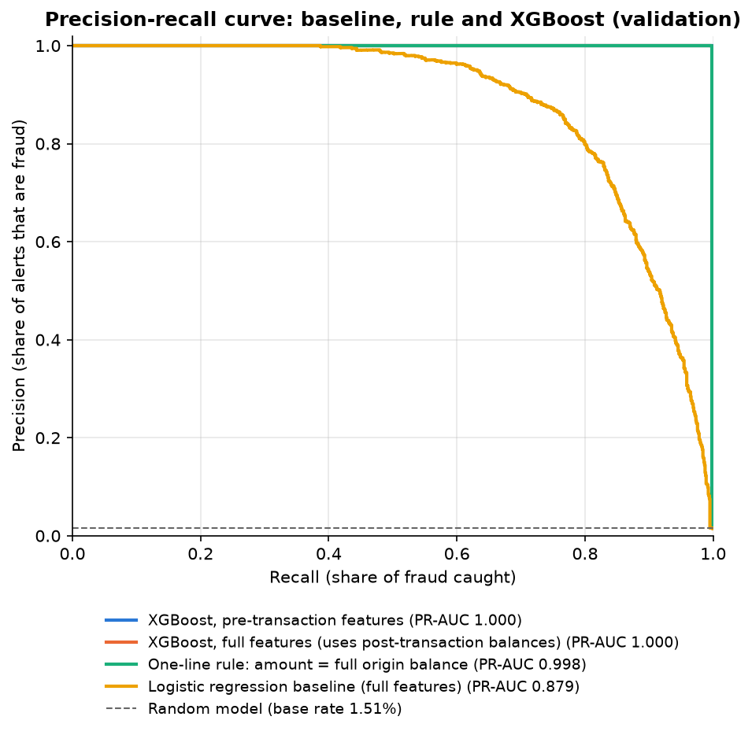

# Transaction Fraud Detection on PaySim

Fraud detection on the [PaySim](https://www.kaggle.com/datasets/ealaxi/paysim1)
synthetic mobile-money dataset: 6.36M transactions, 0.13% fraud.

The headline finding is not a model score. **Every model I trained reached a
near-perfect validation score, and investigating why showed that PaySim fraud
follows an almost deterministic rule**: the fraudster always transfers the
*entire* balance of the account. A one-line rule with no training catches
99.75% of validation fraud with zero false alarms, matching XGBoost.

## What this project demonstrates

- **Imbalanced classification:** models compared on PR-AUC, precision and
  recall; a "never fraud" model is 98.5% accurate and catches nothing.
- **Leakage-safe evaluation:** a time-based train / validation / test split on
  `step`, past-only account features, and a test set left untouched until the end.
- **Questioning results that look too good:** two rounds of leakage checks, from
  post-transaction bookkeeping artefacts down to the rule that generates the fraud.
- **Imbalance strategies:** class weights, SMOTE and undersampling compared
  under identical settings, with a time-safe hyperparameter search.
- Cost-based decision thresholds and SHAP explanations: *in progress*.

## Results (validation set)

Validation covers steps 521 to 632: 78,709 TRANSFER / CASH_OUT transactions,
1,188 frauds, base rate 1.51%. The test set has not been used yet.

| Model | Features | PR-AUC | Frauds caught | False alarms |
|---|---|---|---|---|
| Never fraud | – | 0.015 | 0 | 0 |
| Legacy rule (`isFlaggedFraud`) | – | 0.018 | 3 | 0 |
| Logistic regression | full | 0.879 | 1,168 | 5,341 |
| Logistic regression | pre-transaction | 0.434 | 1,083 | 11,335 |
| XGBoost (tuned) | full | 1.000 | 1,184 | 0 |
| XGBoost (tuned) | pre-transaction | 1.000 | 1,186 | 0 |
| **One-line rule: amount = full origin balance** | amount, opening balance | **0.998** | **1,185** | **0** |

Frauds caught and false alarms are at threshold 0.5 (the rule is already 0/1).
Validation is also used for early stopping and model selection, so these scores
are slightly optimistic.



## How the near-perfect score was investigated

1. **Baseline:** logistic regression reached validation PR-AUC 0.879, a solid
   but believable result.
2. **XGBoost scored 1.000 under every imbalance strategy**, after as few as 11
   trees. That is a warning sign rather than a success.
3. **First suspect: post-transaction balances.** In PaySim, the origin balance
   adds up exactly for 99.4% of frauds but only 9.4% of legitimate transactions,
   and the destination is never credited for 49% of frauds (0.06% of legitimate).
   These are artefacts of how the simulator books fraud, and a bank would not
   have the destination's updated balance at decision time. So I built a
   **pre-transaction** feature set without them.
4. **The pre-transaction model still scored 1.000**, now with a single tree.
   One split was doing all the work.
5. **Root cause:** fraud in PaySim always moves the whole opening balance of the
   origin account (in 10M chunks when larger). This is true for 99.3% of
   training frauds and **for none of the 2.65M legitimate training
   transactions**. A rule that checks only this matches XGBoost.

**Takeaway:** on PaySim, the models are right but there is almost nothing left
for machine learning to learn. Real fraud is not this clean: legitimate
customers sometimes move their whole balance and fraudsters do not always take
all of it, so these scores say nothing about what a bank could expect.

## Key findings from the EDA

- **Severe imbalance:** 8,213 frauds in 6.36M transactions (0.129%).
- **Fraud only in TRANSFER and CASH_OUT** (about 50/50). Keeping just these two
  types removes 56% of rows and loses no fraud.
- **Fraud drains funded accounts:** about 98% of frauds take the origin from a
  positive balance to exactly 0, against about 43% of comparable legitimate
  transactions.
- **The time axis is not stable:** fraud stays at about 260 cases a day while
  legitimate volume falls about 90% after day 17, so the validation and test
  periods have a much higher fraud rate than training (1.5% and 3.3% vs 0.22%).
- **Hour of day is a simulator artefact:** fraud is flat across the day, but
  legitimate activity almost stops overnight.
- **Excluded columns:** `nameOrig` / `nameDest` are almost unique and fraud never
  reuses a destination; `isFlaggedFraud` caught 16 of 8,213 frauds.

## Method

- **Split:** by time on `step` (1 step = 1 hour): train steps 1 to 520, validation
  521 to 632, test 633 to 743. No shuffling across time anywhere.
- **Rows:** TRANSFER and CASH_OUT only.
- **Feature sets:** *full* (amount, balance errors, emptied / new-account flags,
  amount-to-balance ratio, hour, type) and *pre-transaction* (amount, opening
  balances, amount-to-balance ratio, empty-destination flag, hour, type).
- **Models:** class-weighted logistic regression; XGBoost (`hist`, early stopping
  on validation PR-AUC) with four imbalance strategies and a 20-trial random
  search.
- **Metrics:** PR-AUC as the headline, plus precision and recall, always next to
  the base rate. Accuracy is never a headline metric.

## Project structure

```
data/              raw data (not committed)
notebooks/         01_eda, 02_baseline, 03_xgboost (call code in src/)
src/               data loading, features, models, training, evaluation, plots
reports/           metrics (JSON) and figures/
models/            saved models (not committed)
tests/             pytest tests
```

## Setup

```bash
python -m venv .venv
# Windows (Git Bash): source .venv/Scripts/activate
# macOS/Linux:        source .venv/bin/activate
pip install -r requirements.txt
```

Download the dataset from Kaggle, save it as `data/paysim.csv`, then:

```bash
python -m pytest -q
jupyter nbconvert --to notebook --execute --inplace notebooks/01_eda.ipynb
```

## Status

Done: EDA, time-based split and features, baselines, XGBoost with imbalance
strategies, leakage investigation. Next: cost-based threshold selection, SHAP
explanations, and a single final evaluation on the untouched test set.
